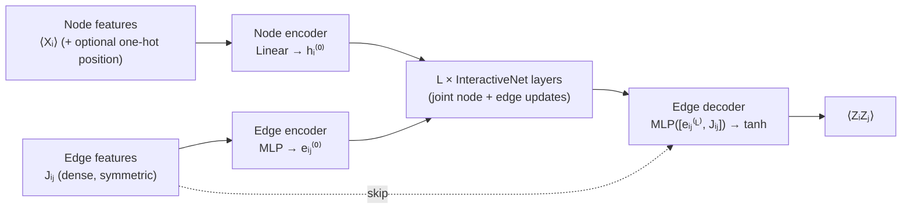

# VDAT-ML

**Graph neural network surrogates for ground-state spin correlations in the transverse-field Ising model.**

VDAT-ML trains neural networks to replace exact diagonalization in a [VDAT](#context) workflow: given local transverse magnetizations ⟨Xᵢ⟩ and couplings Jᵢⱼ, predict the ground-state two-point correlators ⟨ZᵢZⱼ⟩. The main model is a custom message-passing GNN that treats qubits as nodes and couplings as edges, and predicts directly on the edges.

---

## The physics problem

Each sample is a fully connected *N*-qubit transverse-field Ising Hamiltonian:

```math
H(\theta) = \sin\theta \sum_{ij} J_{ij}  Z_i Z_j  -  \cos\theta \sum_i h_i  X_i
```

Ground states are computed by exact diagonalization (Julia, `src/gene_transverse_field_Ising.jl`). The learning task is the map

```math
\big(\langle X_i \rangle,  J_{ij}\big)  \longmapsto  \langle Z_i Z_j \rangle
```

| | Quantity | Where it lives in the graph | Shape (N = 4) |
|---|---|---|---|
| **Input** | ⟨Xᵢ⟩, local transverse magnetization | node features | 4 |
| **Input** | Jᵢⱼ, couplings normalized to ‖J‖ = 1 | edge features | 6 |
| **Target** | ⟨ZᵢZⱼ⟩ ∈ [−1, 1] | edge outputs | 6 |

All computation is in `float64`, because small errors in correlators matter downstream.

---

## Architecture



### InteractiveNet layer

Each layer is a message-passing block in the style of Interaction Networks (Battaglia et al., 2016). It updates **edges first, then nodes**, with GRU-style gates on both:

**1. Edge update.** Edges receive symmetric combinations of their endpoint embeddings:

```math
\Delta e_{ij} = \mathrm{MLP}_e\big([ h_i + h_j,  |h_i - h_j|,  h_i \odot h_j,  e_{ij} ]\big)
```

```math
e_{ij} \leftarrow g \odot e_{ij} + (1-g) \odot \Delta e_{ij}, \qquad g = \sigma\big(W_e[e_{ij}, \Delta e_{ij}]\big)
```

**2. Messages.** Each node receives a message from every other node, conditioned on the updated edge:

```math
m_{ij} = \mathrm{MLP}_m\big([ h_j,  h_i,  e_{ij} ]\big), \qquad a_i = \frac{1}{N-1}\sum_{j \ne i} m_{ij}
```

(Self-messages are masked out. Aggregation can be `mean`, `sum`, or `max`.)

**3. Gated node update:**

```math
\Delta h_i = \mathrm{MLP}_u\big([h_i, a_i]\big), \qquad
h_i \leftarrow g \odot h_i + (1-g) \odot \Delta h_i, \qquad g = \sigma\big(W_h[h_i, \Delta h_i]\big)
```

### Edge decoder

The prediction for each pair is read off the **final edge embedding**, concatenated with the raw coupling as a skip connection, and bounded to the physical range:

```math
\langle Z_i Z_j \rangle_{\text{pred}} = \tanh\Big(\mathrm{MLP}_d\big([ e^{(L)}_{ij},  J_{ij} ]\big)\Big)
```

### Design choices

- **Edge-centric prediction.** The targets are pairwise correlators, so the network carries and refines an explicit edge state instead of reconstructing pairs from node embeddings at the end.
- **Symmetric pair features** (sum, |difference|, product) keep edge updates invariant to swapping *i* and *j*.
- **Gated residuals** on nodes and edges stabilize deeper stacks.
- **Optional one-hot positional encoding** (`n_qubits_pe`) breaks permutation symmetry when you want nodes to be distinguishable even with identical features.

### Dual-head variant (`dual_head_gnn`)

Sign errors account for most of the MSE in near-Ising regimes, so the dual-head model splits the output into two heads on a shared backbone:

| Head | Output | Activation |
|---|---|---|
| Magnitude | \|⟨ZᵢZⱼ⟩\| ∈ [0, 1] | sigmoid |
| Sign | logit for P(⟨ZᵢZⱼ⟩ > 0) | none (BCE with logits) |

The prediction is reconstructed as ZZ = (2σ(s) − 1)·|ZZ|. The loss combines MSE on magnitude with BCE on sign. The sign term is weighted per edge by the target magnitude |ZZ|, so near-zero (sign-ambiguous) correlators don't dominate. The two tasks are balanced with learned uncertainty weights (Kendall et al., 2018):

```math
\mathcal{L} = e^{-2\log\sigma_m} \mathcal{L}_{\text{mag}} + \log\sigma_m  +  e^{-2\log\sigma_s} \mathcal{L}_{\text{sign}} + \log\sigma_s
```

### Baseline

An MLP baseline (`model=mlp`) maps the flat vector [⟨Xᵢ⟩, Jᵢⱼ] to all six correlators, with configurable width and depth, LayerNorm, and a tanh output.

---

## Data

Training data is generated by sampling Hamiltonian parameters and solving each instance exactly. `scripts/generate_data.py` calls the Julia oracle through PyJulia.

| Distribution | Description |
|---|---|
| `random` | hᵢ ∈ [0, 1], Jᵢⱼ ∈ [−1, 1], θ ∈ [0, π/2] uniform |
| `sobol` | Quasi-random Sobol sequence over the same space |
| `normal` | Unit-norm J, θ swept over 10 values in [0, π/2] |
| `ising` | Pure Ising limit (h = 0, θ = π/2) |
| `coulomb` | Ising limit with all-positive (antiferromagnetic) couplings |
| `mixed` | Weighted mix of normal, Ising, dimer, near-Ising, and field-dominated cases |

Datasets used so far range from 100k to 6.1M samples (4 qubits, 6 edges), with an 80/10/10 train/val/test split.

---

## Quick start

```bash
# Environment
./setup.sh cpu        # or: ./setup.sh gpu

# Generate data (exact diagonalization)
python scripts/generate_data.py --dist mixed --n_samples 500000 --n_qubits 4

# Train
python src/train.py data=mixed_500k_4q_graph model=gnn
python src/train.py data=mixed_500k_4q_graph model=gnn model.name=dual_head_gnn

# Evaluate a checkpoint
python src/evaluate.py checkpoint=outputs/.../checkpoints/best.pt data=mixed_500k_4q_graph model=gnn
```

Configuration is managed with [Hydra](https://hydra.cc/) and runs are tracked in Weights & Biases. See **[HANDBOOK.md](HANDBOOK.md)** for sweeps, overrides, and the full config reference.

---

## Repository layout

```
├── src/
│   ├── models.py                      # MLP, GNN, InteractiveNet, DualHeadGNN, DualHeadLoss
│   ├── data.py                        # Tensor and PyG graph datasets, loaders
│   ├── train.py                       # Hydra training entry point
│   ├── evaluate.py                    # Checkpoint evaluation
│   ├── utils.py                       # Seeding, checkpoints, early stopping
│   └── gene_transverse_field_Ising.jl # Exact-diagonalization oracle (Julia)
├── scripts/
│   ├── generate_data.py               # Dataset generation via the Julia oracle
│   └── inference.py                   # Run a trained model on VDAT output files
├── configs/                           # Hydra configs: model / data / optimizer / experiment
└── HANDBOOK.md                        # Detailed usage guide
```

---

## Context

This project was developed at Brookhaven National Laboratory in collaboration with Columbia University. The model serves as a fast surrogate for the exact-diagonalization step that maps local observables and couplings to correlators within the variational discrete action theory (VDAT) framework. `scripts/inference.py` reads VDAT output files and compares model predictions against the reference observable.

## References

- P. W. Battaglia et al., *Interaction Networks for Learning about Objects, Relations and Physics*, NeurIPS (2016).
- A. Kendall, Y. Gal, R. Cipolla, *Multi-Task Learning Using Uncertainty to Weigh Losses*, CVPR (2018).
